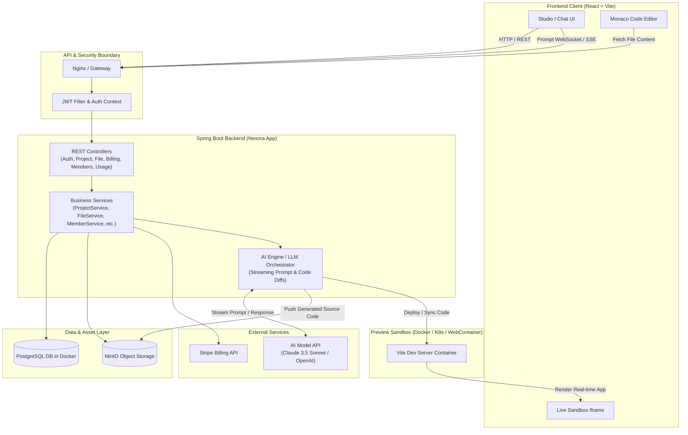
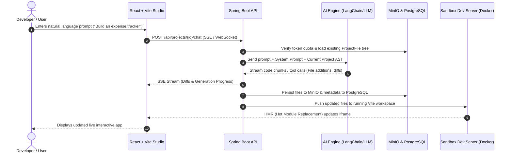

# Nexora Platform - System Architecture, API Specification & Technical Analysis

> **Project Name:** Nexora (`com.gtcoder.projects:nexora`)  
> **Platform Category:** AI-Powered Full-Stack Web Application Generator (Lovable Clone)  
> **Target Tech Stack:** Spring Boot (Java 17), React.js + Vite, PostgreSQL (Dockerized), MinIO Object Storage, Docker/Kubernetes Preview Engine  
> **Document Status:** Comprehensive Baseline Analysis & Technical Blueprint  

---

## 1. Executive Summary & Tech Stack Overview

Nexora is designed as an end-to-end distributed AI web application generator inspired by Lovable.dev and v0.dev. The platform allows users to describe web applications in natural language, automatically provisions project structures, generates React/Vite codebases via LLM pipelines, persists files, manages team access, monitors token usage, and serves live interactive previews in isolated sandboxes.

### Target Technology Stack

```
┌────────────────────────────────────────────────────────────────────────┐
│                        Nexora System Stack                             │
├────────────────────────────────┬───────────────────────────────────────┤
│ Frontend (Client & Studio)     │ React 18/19, Vite, Tailwind CSS,      │
│                                │ Monaco Editor, Sandpack / WebContainer│
├────────────────────────────────┼───────────────────────────────────────┤
│ Backend Application Server     │ Java 17, Spring Boot, Spring Web MVC, │
│                                │ Spring Data JPA, Hibernate, MapStruct │
├────────────────────────────────┼───────────────────────────────────────┤
│ Database & Persistence         │ PostgreSQL 16+ (Dockerized container) │
│                                │ MinIO / S3 for generated file storage │
├────────────────────────────────┼───────────────────────────────────────┤
│ Live Preview & Sandboxing      │ Docker / Kubernetes Pods / WebContainer│
├────────────────────────────────┼───────────────────────────────────────┤
│ External Integrations          │ Stripe (Billing & Checkout), LLM APIs │
│                                │ (Anthropic Claude 3.5 Sonnet / OpenAI)│
└────────────────────────────────┴───────────────────────────────────────┘
```

---

## 2. Complete Class Diagram

The following diagram illustrates the complete domain model, data transfer records, controllers, services, repositories, and their architectural relationships.

```mermaid
classDiagram
    %% ENUMS
    class MessageRole {
        <<enumeration>>
        USER
        ASSISTANT
        SYSTEM
        TOOL
    }

    class PreviewStatus {
        <<enumeration>>
        CREATING
        RUNNING
        FAILED
        TERMINATED
    }

    class ProjectRole {
        <<enumeration>>
        EDITOR
        VIEWER
    }

    class SubscriptionStatus {
        <<enumeration>>
        ACTIVE
        TRIALING
        CANCELED
        PAST_DUE
        INCOMPLETE
    }

    %% ENTITIES
    class User {
        Long id
        String email
        String passwordHash
        String name
        String avatarUrl
        Instant createdAt
        Instant updatedAt
        Instant deletedAt
    }

    class Project {
        Long id
        String name
        User owner
        Boolean isPublic
        Instant createdAt
        Instant updatedAt
        Instant deleteAt
    }

    class ProjectMember {
        ProjectMemberId id
        Project project
        User user
        ProjectRole projectRole
        Instant invitedAt
        Instant acceptedAt
    }

    class ProjectMemberId {
        Long projectId
        Long userId
    }

    class ProjectFile {
        Long id
        Project project
        String path
        String minioObjectKey
        Instant createdAt
        Instant updateAt
        User createdBy
        User updatedBy
    }

    class ChatSession {
        Long id
        Project project
        User user
        String title
        Instant createdAt
        Instant updatedAt
        Instant deletedAt
    }

    class ChatMessage {
        Long id
        ChatSession chatSession
        String content
        MessageRole role
        String toolCalls
        Integer tokensUsed
        Instant createdAt
    }

    class Preview {
        Long id
        Project project
        String namespace
        String podName
        String previewUrl
        PreviewStatus status
        Instant terminatedAt
        Instant createdAt
    }

    class Plan {
        Long id
        String name
        String stripePrice
        Integer maxProjects
        Integer maxTokensPerDay
        Integer maxPreviews
        Boolean unlimitedAt
        Boolean active
    }

    class Subscription {
        Long id
        User user
        Plan plan
        SubscriptionStatus status
        String stripeCustomerId
        String stripeSubscriptionId
        Instant currentPeriodStart
        Instant currentPeriodEnd
        Boolean cancelAtPeriodEnd
        Instant createdAt
        Instant updatedAt
    }

    class UsageLog {
        Long id
        User user
        Project project
        String action
        Integer tokensUsed
        Long durationMs
        String metaData
        Instant createdAt
    }

    %% RELATIONSHIPS
    Project "1" --> "1" User : owner
    ProjectMember "1" --> "1" Project : project
    ProjectMember "1" --> "1" User : user
    ProjectMember "1" --> "1" ProjectMemberId : id
    ProjectFile "1" --> "1" Project : project
    ProjectFile "1" --> "1" User : createdBy
    ProjectFile "1" --> "1" User : updatedBy
    ChatSession "1" --> "1" Project : project
    ChatSession "1" --> "1" User : user
    ChatMessage "1" --> "1" ChatSession : chatSession
    ChatMessage "1" --> "1" MessageRole : role
    Preview "1" --> "1" Project : project
    Preview "1" --> "1" PreviewStatus : status
    Subscription "1" --> "1" User : user
    Subscription "1" --> "1" Plan : plan
    Subscription "1" --> "1" SubscriptionStatus : status
    UsageLog "1" --> "1" User : user
    UsageLog "1" --> "1" Project : project
    ProjectMember "1" --> "1" ProjectRole : projectRole

    %% CONTROLLERS
    class AuthController {
        -AuthService authService
        -UserService userService
        +signup(SignupRequest) ResponseEntity~AuthResponse~
        +login(LoginRequest) ResponseEntity~AuthResponse~
        +getProfile() ResponseEntity~UserProfileResponse~
    }

    class ProjectController {
        -ProjectService projectService
        +getMyProjects() ResponseEntity~List~ProjectSummaryResponse~~
        +getProjectById(Long) ResponseEntity~ProjectResponse~
        +crateProject(ProjectRequest) ResponseEntity~ProjectResponse~
        +updateProject(Long, ProjectRequest) ResponseEntity~ProjectResponse~
        +deleteProject(Long) ResponseEntity~Void~
    }

    class FileController {
        -FileService fileService
        +getFileTree(Long) ResponseEntity~List~FileNode~~
        +getFile(Long, String) ResponseEntity~FileContentResponse~
    }

    class BillingController {
        -PlanService planService
        -SubscriptionService subscriptionService
        +getAllPlans() ResponseEntity~List~PlanResponse~~
        +getMySubscription() ResponseEntity~SubscriptionResponse~
        +createCheckoutResponse(CheckoutRequest) ResponseEntity~CheckoutResponse~
        +openCustomerPortal() ResponseEntity~PortalResponse~
    }

    class ProjectMemberController {
        -ProjectMemberService projectMemberService
        +getProjectMembers(Long) ResponseEntity~List~MemberResponse~~
        +inviteMember(Long, InviteMemberRequest) ResponseEntity~MemberResponse~
        +updateMemberRole(Long, Long, UpdateMemberRoleRequest) ResponseEntity~MemberResponse~
        +deleteMember(Long, Long) ResponseEntity~MemberResponse~
    }

    class UsageController {
        -UsageService usageService
        +getTodayUsage() ResponseEntity~UsageTodayResponse~
        +getPlansLimits() ResponseEntity~PlanLimitsResponse~
    }

    %% SERVICES
    class ProjectService {
        <<interface>>
        +createProject(ProjectRequest, Long) ProjectResponse
        +getUserProjects(Long) List~ProjectSummaryResponse~
        +getUserProjectById(Long, Long) ProjectResponse
        +updateProject(Long, ProjectRequest, Long) ProjectResponse
        +softDelete(Long, Long) void
    }

    class AuthService {
        <<interface>>
        +signup(SignupRequest) AuthResponse
        +login(LoginRequest) AuthResponse
    }

    class FileService {
        <<interface>>
        +getFileTree(Long, Long) List~FileNode~
        +getFileContent(Long, String, Long) FileContentResponse
    }

    class ProjectMemberService {
        <<interface>>
        +getProjectMembers(Long, Long) List~MemberResponse~
        +inviteMember(Long, InviteMemberRequest, Long) MemberResponse
        +updateMemberRole(Long, Long, UpdateMemberRoleRequest, Long) MemberResponse
        +deleteProjectMember(Long, Long, Long) MemberResponse
    }

    class SubscriptionService {
        <<interface>>
        +getCurrentSubscription(Long) SubscriptionResponse
        +createCheckoutSessionUrl(CheckoutRequest, Long) CheckoutResponse
        +openCustomerPortal(Long) PortalResponse
    }

    class PlanService {
        <<interface>>
        +getAllActivePlans() List~PlanResponse~
    }

    class UsageService {
        <<interface>>
        +getTodayUsageDfUser(Long) UsageTodayResponse
        +getCurrentSubscriptionLimitsOfUser(Long) PlanLimitsResponse
    }

    class UserService {
        <<interface>>
        +getProfile(Long) UserProfileResponse
    }

    %% REPOSITORIES & MAPPERS
    class ProjectRepository {
        <<interface>>
        +findAllAccessibleByUser(Long) List~Project~
    }

    class UserRepository {
        <<interface>>
        +findById(Long) Optional~User~
    }

    class ProjectMapper {
        <<interface>>
        +toProjectResponse(Project) ProjectResponse
        +toProjectSummaryReponse(Project) ProjectSummaryResponse
    }

    %% CONNECTIONS
    AuthController ..> AuthService
    AuthController ..> UserService
    ProjectController ..> ProjectService
    FileController ..> FileService
    BillingController ..> PlanService
    BillingController ..> SubscriptionService
    ProjectMemberController ..> ProjectMemberService
    UsageController ..> UsageService

    ProjectServiceImpl ..|> ProjectService
    ProjectServiceImpl ..> ProjectRepository
    ProjectServiceImpl ..> UserRepository
    ProjectServiceImpl ..> ProjectMapper
```



---

## 3. Dataflow Diagrams

### 3.1 High-Level System Architecture & Flow



### 3.2 End-to-End Code Generation Dataflow



---

## 4. Comprehensive REST API Specification

The backend currently registers **17 REST endpoints** across 6 functional controllers:

| HTTP Method | Endpoint Path | Description | Request Body | Response Body | Current Status |
| :--- | :--- | :--- | :--- | :--- | :--- |
| **POST** | `/api/auth/signup` | Register new user account | `SignupRequest` (`email`, `name`, `password`) | `AuthResponse` (`token`, `UserProfileResponse`) | Stubbed (Returns `null`) |
| **POST** | `/api/auth/login` | Authenticate user with credentials | `LoginRequest` (`email`, `password`) | `AuthResponse` (`token`, `UserProfileResponse`) | Stubbed (Returns `null`) |
| **GET** | `/api/auth/me` | Fetch authenticated user's profile | *None* | `UserProfileResponse` (`id`, `email`, `name`, `avatarUrl`) | Stubbed (`userId=1L`) |
| **GET** | `/api/projects` | List all projects accessible to current user | *None* | `List<ProjectSummaryResponse>` | **Implemented** |
| **POST** | `/api/projects` | Create a new project workspace | `ProjectRequest` (`name`) | `ProjectResponse` | **Implemented** (`userId=3L` hardcoded) |
| **GET** | `/api/projects/{id}` | Retrieve specific project details | *None* | `ProjectResponse` | Stubbed (Returns `null`) |
| **PATCH** | `/api/projects/{id}` | Rename or update project metadata | `ProjectRequest` (`name`) | `ProjectResponse` | Stubbed (Returns `null`) |
| **DELETE**| `/api/projects/{id}` | Soft delete project | *None* | *204 No Content* | Stubbed (Returns `null`) |
| **GET** | `/api/projects/{projectId}/files` | Get full virtual directory file tree | *None* | `List<FileNode>` | Stubbed (Returns `null`) |
| **GET** | `/api/projects/{projectId}/files/{*path}` | Fetch file contents from path | *None* | `FileContentResponse` (`path`, `content`) | Stubbed (Returns `null`) |
| **GET** | `/api/projects/{projectId}/members` | List collaborators and roles | *None* | `List<MemberResponse>` | Stubbed (Returns `null`) |
| **POST** | `/api/projects/{projectId}/members/{userId}` | Invite collaborator to project | `InviteMemberRequest` (`email`, `role`) | `MemberResponse` | Stubbed (Returns `null`) |
| **PATCH**| `/api/projects/{projectId}/members/{memberId}` | Update member role (`EDITOR`/`VIEWER`) | `UpdateMemberRoleRequest` (`role`) | `MemberResponse` | Stubbed (Returns `null`) |
| **DELETE**| `/api/projects/{projectId}/members/{memberId}` | Remove collaborator from project | *None* | `MemberResponse` | Stubbed (Returns `null`) |
| **GET** | `/api/plans` | List available subscription tiers | *None* | `List<PlanResponse>` | Stubbed (Returns `null`) |
| **GET** | `/api/me/subscription` | Fetch active user subscription | *None* | `SubscriptionResponse` | Stubbed (Returns `null`) |
| **POST** | `/api/stripe/checkout` | Create Stripe checkout session URL | `CheckoutRequest` (`planId`) | `CheckoutResponse` (`checkoutUrl`) | Stubbed (Returns `null`) |
| **PUT** | `/api/stripe/portal` | Access Stripe billing customer portal | *None* | `PortalResponse` (`portalUrl`) | Stubbed (Returns `null`) |
| **GET** | `/api/usage/today` | Current day token & preview usage | *None* | `UsageTodayResponse` | Stubbed (Returns `null`) |
| **GET** | `/api/usage/limits` | Active plan quotas and limits | *None* | `PlanLimitsResponse` | Stubbed (Returns `null`) |

---

## 5. Proposed Docker Architecture

To run PostgreSQL alongside necessary auxiliary services locally:

```yaml
# docker-compose.yml
version: '3.8'

services:
  postgres:
    image: postgres:16-alpine
    container_name: nexora-postgres
    restart: unless-stopped
    environment:
      POSTGRES_DB: myapp
      POSTGRES_USER: postgres
      POSTGRES_PASSWORD: admin123
    ports:
      - "5432:5432"
    volumes:
      - postgres_data:/var/lib/postgresql/data

  minio:
    image: minio/minio:RELEASE.2024-05-10T01-41-38Z
    container_name: nexora-minio
    restart: unless-stopped
    command: server /data --console-address ":9001"
    environment:
      MINIO_ROOT_USER: minioadmin
      MINIO_ROOT_PASSWORD: minioadminpassword
    ports:
      - "9000:9000"
      - "9001:9001"
    volumes:
      - minio_data:/data

  redis:
    image: redis:7-alpine
    container_name: nexora-redis
    restart: unless-stopped
    ports:
      - "6379:6379"

volumes:
  postgres_data:
  minio_data:
```

---

## 6. Honest Technical Review of Current State

### 6.1 Strengths & Good Architectural Choices

1. **Clear Modular Architecture:**  
   The application cleanly segregates responsibilities across `controller`, `dto`, `entity`, `repository`, `service`, and `mapper` layers.
2. **Modern Java Records for DTOs:**  
   Utilizing immutable Java records for request and response payloads guarantees clean thread safety and eliminates boilerplates.
3. **MapStruct Integration:**  
   Using compile-time MapStruct mapping (`ProjectMapper`) rather than runtime reflection (like ModelMapper) provides exceptional throughput and type safety.
4. **Thoughtful Domain Modeling:**  
   The entity definitions anticipate critical production requirements:
   - Soft deletes (`deletedAt`).
   - Token accounting and daily limit tracking (`tokensUsed`, `UsageLog`).
   - Kubernetes namespace & pod metadata in `Preview` entity.
   - S3/MinIO storage references via `minioObjectKey` in `ProjectFile`.

---

### 6.2 Critical Gaps & Technical Debt

1. **Missing JPA Annotations on Domain Entities:**  
   Only `Project` and `User` are annotated with `@Entity`, `@Table`, and `@Id`. The other 8 domain classes (`ChatMessage`, `ChatSession`, `Plan`, `Preview`, `ProjectFile`, `ProjectMember`, `Subscription`, `UsageLog`) are plain Java POJOs. Hibernate will not create database tables for them, and no repositories exist to query or persist them.
2. **Stubbed Services:**  
   Except for `ProjectServiceImpl.createProject` and `getUserProjects`, all service methods return `null`. The business logic for authentication, files, subscriptions, and members is unwritten.
3. **Absence of Spring Security & JWT:**  
   There is no Spring Security filter chain or JWT parsing. All endpoints rely on hardcoded test values like `Long userId = 1L;` or `Long userId = 3L;`.
4. **Typographical & Logic Bugs in Existing Code:**
   - In `ProjectController.java`, the create method is named `crateProject` instead of `createProject`, with hardcoded `Long userId = 3L;`.
   - In `UsageService.java`, the method is named `getTodayUsageDfUser` instead of `getTodayUsageOfUser`.
   - In `Project.java`, the soft delete column is named `deleteAt`, whereas in `User.java` it is `deletedAt`.
5. **Spring Boot Version Anomaly:**  
   `pom.xml` references `<version>4.1.1</version>` for `spring-boot-starter-parent`. Spring Boot 4 is not a general production release; standard production builds should use `3.3.x` or `3.4.x`.
6. **No Frontend Codebase:**  
   While the requested tech stack targets React.js + Vite, there is no frontend workspace (e.g. `client/` or `frontend/` directory with `package.json`, Tailwind, or Vite config).
7. **No AI Engine / LLM Integration:**  
   A Lovable clone requires prompt processing, AST parsing, file diff streaming, and LLM orchestration (e.g. via Spring AI or LangChain4j), none of which has been scaffolded yet.
8. **No Live Sandbox Orchestrator:**  
   Previewing generated code in real time requires either WebContainer technology in the browser or dynamic Docker container spin-up with port proxying.

---

## 7. Future Enhancements & Feature Roadmap

### Phase 1: Core Foundation & Database Completion (Weeks 1-2)
- [ ] Add `@Entity`, `@Table`, `@Id`, and relation annotations (`@OneToMany`, `@ManyToOne`) to `ChatMessage`, `ChatSession`, `Plan`, `Preview`, `ProjectFile`, `ProjectMember`, `Subscription`, and `UsageLog`.
- [ ] Create corresponding Spring Data JPA repositories (`ProjectFileRepository`, `ChatSessionRepository`, `ChatMessageRepository`, `SubscriptionRepository`, `UsageLogRepository`).
- [ ] Implement Spring Security 6 with stateless JWT Bearer token authentication, BCrypt password hashing, and SecurityContext principal injection.
- [ ] Add Flyway or Liquibase for managed database schema migrations.

### Phase 2: React + Vite Studio Frontend (Weeks 3-4)
- [ ] Initialize Vite + React + TypeScript in a `/frontend` or `/client` directory.
- [ ] Implement layout:
  - Left pane: Chat interface with streaming markdown & prompt suggestions.
  - Middle pane: File tree explorer and Monaco Code Editor.
  - Right pane: Live sandbox preview iframe.
- [ ] Integrate React Query / TanStack Query for server state and Zustand for studio workspace state.

### Phase 3: AI Code Generation Engine (Weeks 5-6)
- [ ] Integrate **Spring AI** or Anthropic/OpenAI SDK.
- [ ] Implement Server-Sent Events (SSE) or WebSockets at `/api/projects/{id}/chat/stream`.
- [ ] Design System Prompting with tool calling (e.g., `create_file`, `update_file`, `delete_file`).
- [ ] Add AST-based diff engine so changes apply surgically without rewriting entire files.

### Phase 4: File Storage & Preview Sandbox (Weeks 7-8)
- [ ] Integrate MinIO Java SDK to store and serve generated project files.
- [ ] Implement WebContainer API (in-browser Node.js/Vite runner) or Docker-based sandbox orchestrator to execute generated React code and serve previews with live HMR.

### Phase 5: Billing, Git & Deployment Integrations (Weeks 9-10)
- [ ] Implement Stripe Webhook handler (`POST /api/stripe/webhook`) for subscription lifecycle events.
- [ ] Add one-click GitHub sync (exporting generated repositories to GitHub via GitHub REST API).
- [ ] Add one-click export to ZIP and automated deployments to Vercel or Netlify.
- [ ] Token rate limiter using Redis Token Bucket algorithm to protect against abuse.
